# STIG GPO Manager

**The quarterly DISA STIG GPO update, in four steps: Prepare, Review, Pilot, Promote.**

Drop in DISA's GPO package. The tool imports each GPO as a new, versioned GPO, shows exactly what
changed against the version in use and against your site exception GPOs, pilots it, and promotes it.
Exception GPOs always stay on top, the old version is disabled (not deleted) so rollback is one click,
and every change is written to an append-only audit log. A calendar on the home screen shows every
quarterly update (past, current and the next DISA release) and where the current one is, including
the pilot soak countdown.

Built for air-gapped, accredited networks: no internet access, no telemetry, nothing downloaded at
run time and no third-party DLLs. It uses only what ships with Windows Server 2025 / Windows 11:
.NET Framework 4.8, Windows PowerShell 5.1 and the RSAT `GroupPolicy` / `ActiveDirectory` modules.

**[Download the latest release](https://github.com/casea1/STIGPush/releases)** (`StigGpoManager-Setup-<version>.exe`)

> Test a full quarter in a lab domain before production use. The same build works in both; only the
> configuration differs, and the setup wizard detects it for each domain.

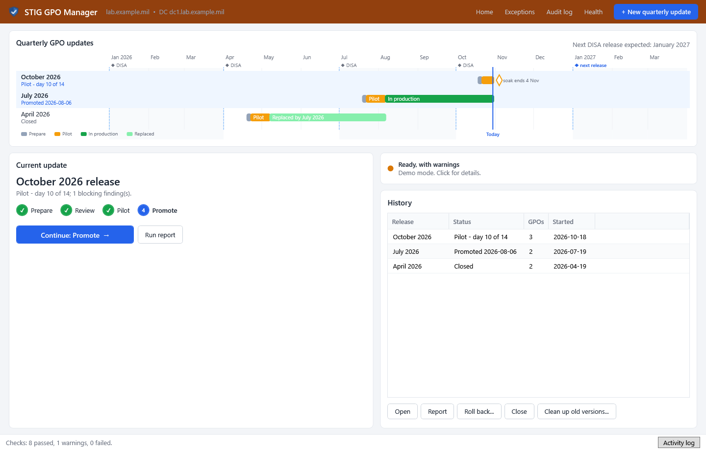

## Contents

- [Install](#install)
- [Using it each quarter](#using-it-each-quarter)
- [Rolling back](#rolling-back)
- [Settings reference](#settings-reference)
- [Where data lives](#where-data-lives)
- [Command line](#command-line)
- [How link order is decided](#how-link-order-is-decided)
- [Building from source](#building-from-source)
- [Status and limits](#status-and-limits)

## Install

1. Bring `StigGpoManager-Setup-<version>.exe` into the enclave through your approved transfer process.
   Check it against the SHA-256 published with the release.
2. Run it on the **PDC emulator** of each network (or a management server with RSAT). It installs to
   `C:\Program Files\StigGpoManager`, adds a Start menu entry (plus a **demo** entry that runs on a
   simulated domain), appears in **Programs and Features**, and optionally shows a status icon in the
   notification area at logon ("Pilot - day 9 of 14").
3. The first start opens the **setup wizard**. It detects the domain, PDC, OU tree, your
   exception-GPO prefix (from existing GPO names), a pilot group, and one mapping per DISA GPO you
   already have linked. Check each page and save. Nothing in AD is changed by setup.

The same setup file **upgrades** an installed copy, keeping the configuration, history and audit log.
Uninstalling keeps them too (they are audit evidence). Silent install: `StigGpoManager-Setup-<version>.exe /VERYSILENT /TASKS=tray`.

Requirements: Windows Server 2025 (DC or member with RSAT) or Windows 11 with RSAT; a member of
**Domain Admins**, running elevated (the tool asks for elevation); an existing Central Store.

The tool's own data (`WorkingFolder`) is ordinary files and does not replicate: include it in that
server's backups, or point it at an admin-only share. On an accredited network, sign the exe and the
setup file with your code-signing certificate if you have one, or add an AppLocker/WDAC hash rule.

## Using it each quarter

Nothing in Active Directory changes until you confirm it. Every change first opens a window that
lists exactly what will happen, including the before/after link order on each OU. Promote and Delete
also make you type `PROMOTE` / `DELETE`.

**Home** shows the calendar, the **current update** with one **Continue** button, domain **health**,
and the **history** of past updates (open, report, roll back, close). Click **New quarterly update**
when DISA's package has been transferred in.

| Stage | What you do | Changes AD? |
|---|---|---|
| **1. Prepare** | Drop the zip. The tool shows its SHA-256 (paste the expected hash to compare), lists every GPO in the package and the name each will get, e.g. `DoD WinSvr2025 MS STIG Comp v1r4`. Red rows match none of your mappings: pick one, or use *Use suggested mappings*. Click **Import**. | Backs up every GPO, updates the Central Store if newer templates are in the package (never downgrades), and creates the new GPOs. Never overwrites an existing GPO; links nothing. |
| **2. Review** | Read the flagged rows; the full HTML/CSV report is saved. **Red**: a user right or restricted group that one of your exception GPOs replaces (its list must contain every STIG entry). **Yellow**: an exception that may need review or may no longer be needed. | No |
| **3. Pilot** | Click **Start pilot**, then gpupdate and scan the pilot machines and test. Drop SCC / Evaluate-STIG results (CKL, CKLB, XCCDF) here: open findings, and rules the scanner reported as *error*, block Promote unless they're in the exceptions register. A host where no rule was evaluated at all (every result error or not checked) also blocks: that scan didn't really run. The soak countdown runs; you can close the tool and come back. | Links the new GPOs to the pilot OUs (or at production, filtered to the pilot group), below your exception GPOs. |
| **4. Promote** | Click **Promote to production** and type PROMOTE, then refresh policy on the listed computers. | Links the new GPOs to production, disables the old version's links (kept for rollback), removes pilot links. |

Next quarter, **Clean up old versions** (on Home) lists DISA GPOs two or more versions old with no
enabled links. The newest and the one before it (your rollback) are always kept. Each one is backed up,
then deleted.

**Tools** (top bar): **Exceptions**, the register of accepted deviations used by the scan gate
(V-ID, justification, POA&M reference); **Audit log**; **Health**, with the pre-flight checks
(modules, rights, PDC, Central Store, OUs, optional dcdiag) and the setup wizard.

**Things to know**
- **Matching uses the GPO names inside DISA's package**, not the computer you run on. DISA
  abbreviates differently between products ("WinSvr 2025 MS STIG Comp" vs "Member Server ...
  Computer"); mappings match either form.
- **Exceptions inherited from a parent OU.** A GPO linked directly on a pilot OU beats GPOs inherited
  from its parent, so during an OU-based pilot an exception linked only on the parent OU loses on pilot
  machines. The tool warns about this. Link the exception to the pilot OU too, or use group-based pilot.
- **Single-DC domains.** Changes to the Domain Controllers OU require confirming a fresh system-state backup.
- Every screen can be tried on a simulated domain: Start menu > **STIG GPO Manager (demo)**, or `StigGpoManager.exe /demo`.

<details>
<summary>More screenshots</summary>

| | |
|---|---|
| 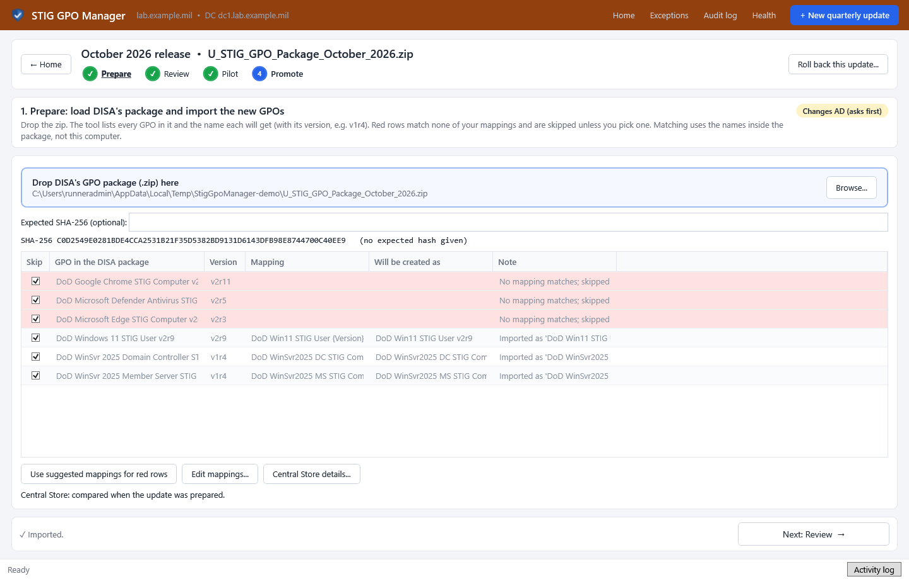 1. Prepare | 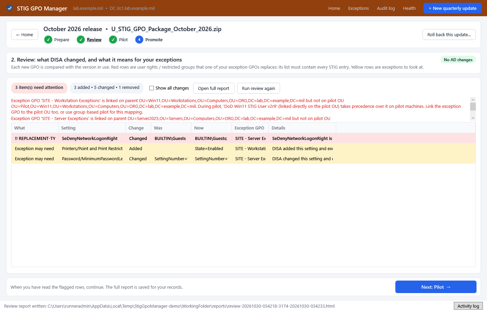 2. Review |
| 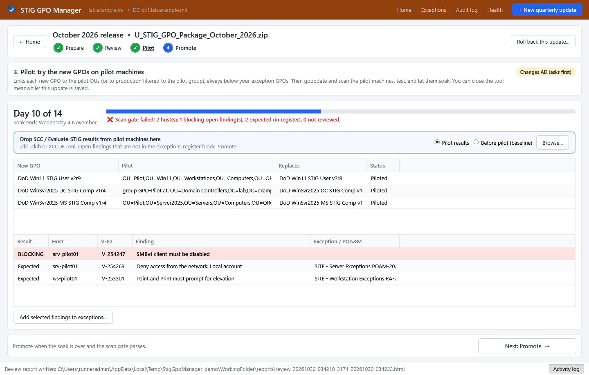 3. Pilot (soak countdown, scan gate) | 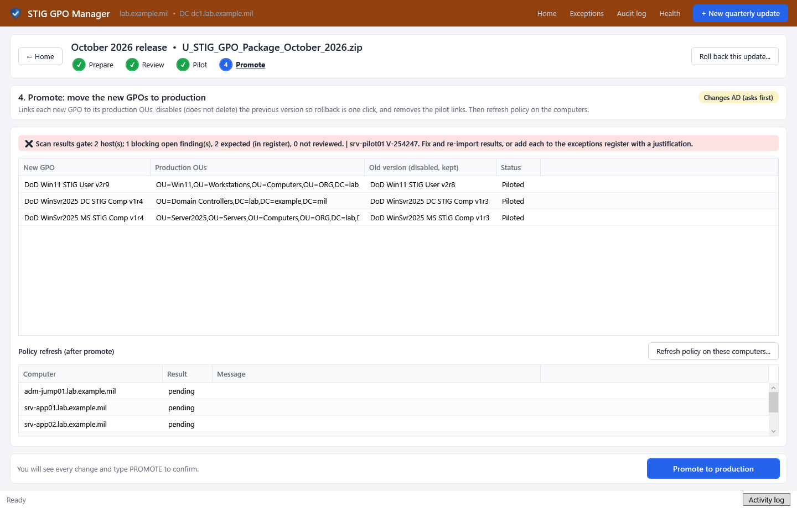 4. Promote |
| 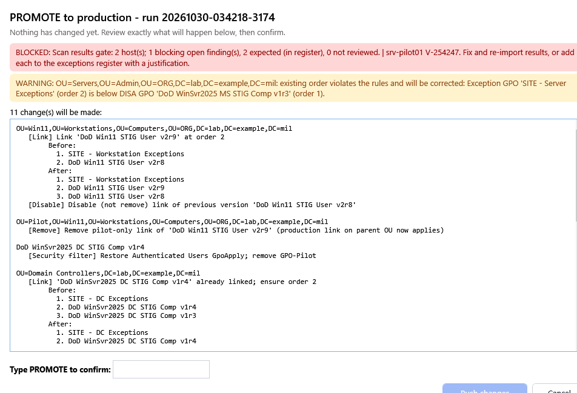 Every change is shown before it happens | 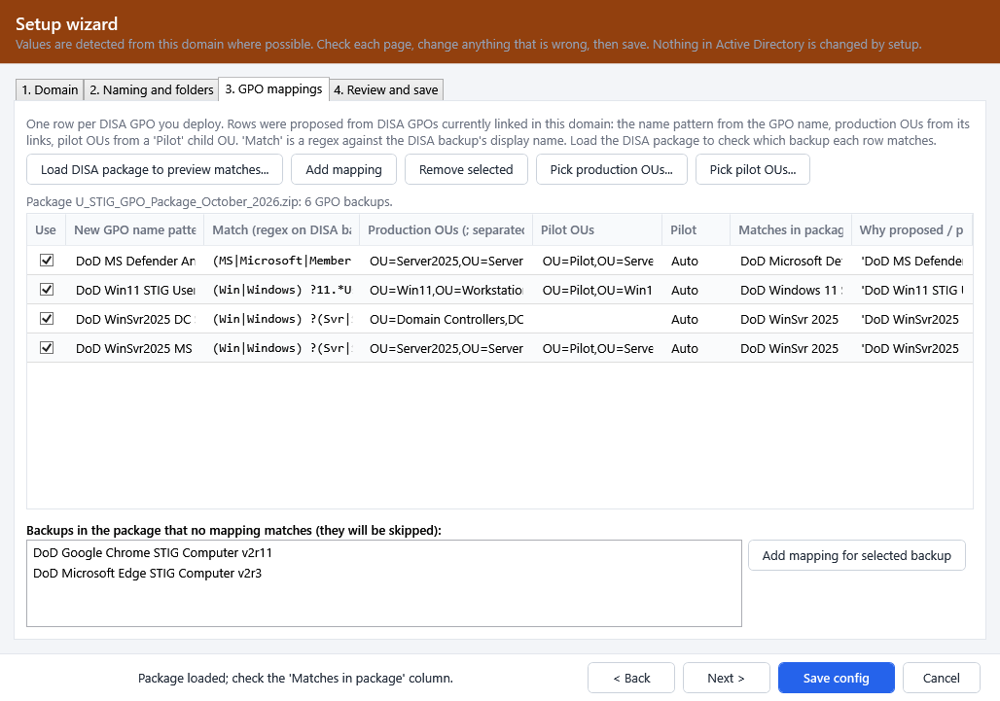 Setup wizard: detected mappings |
| 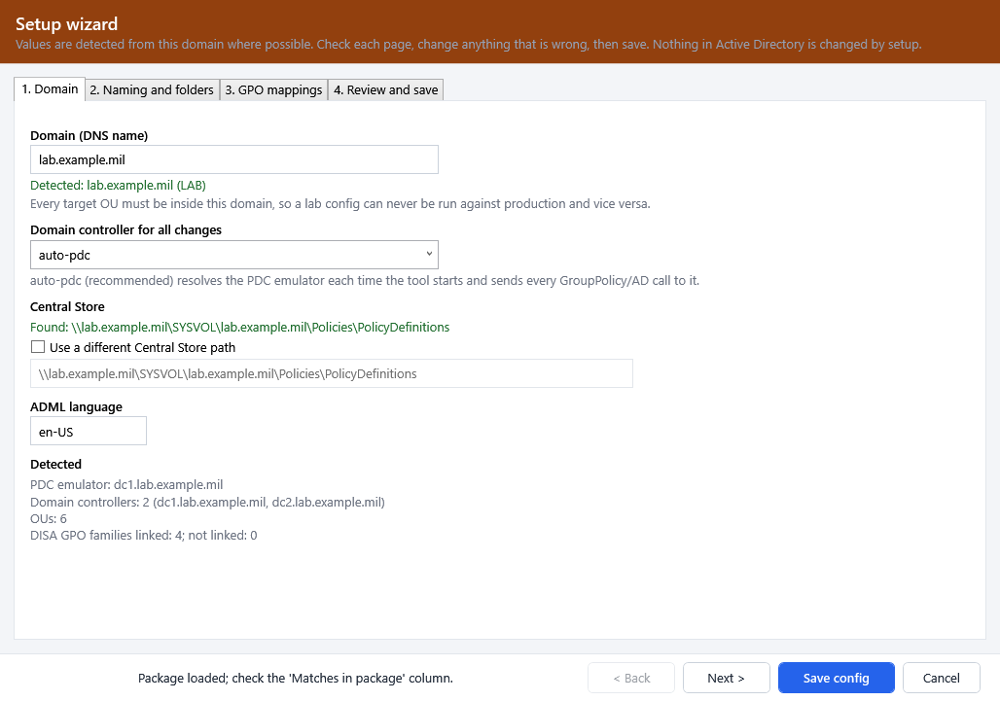 Setup: domain | 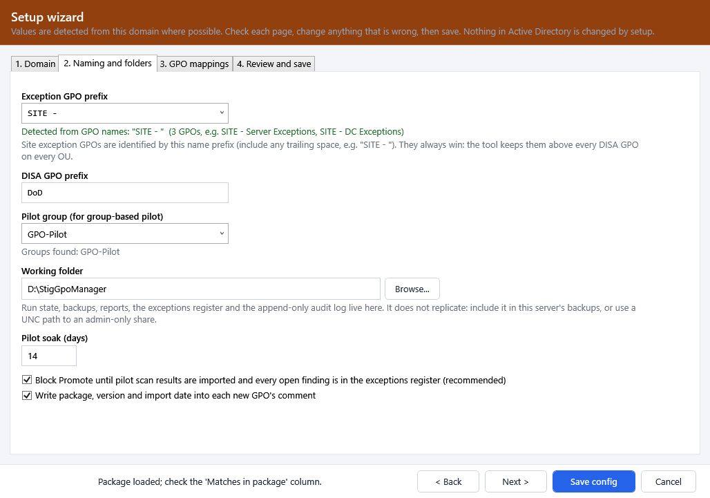 Setup: naming and folders |
| 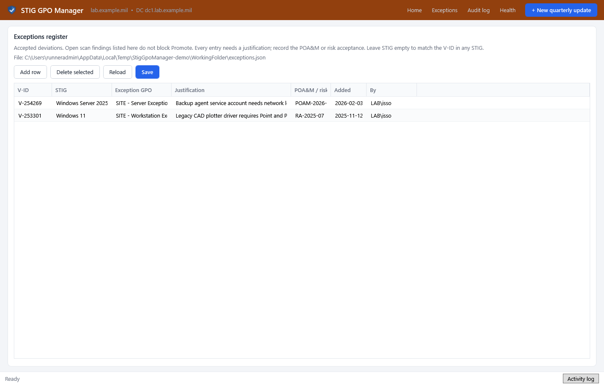 Exceptions register | 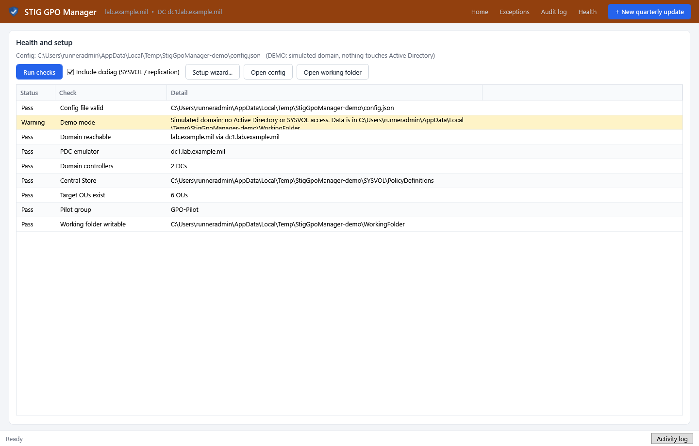 Health |
| 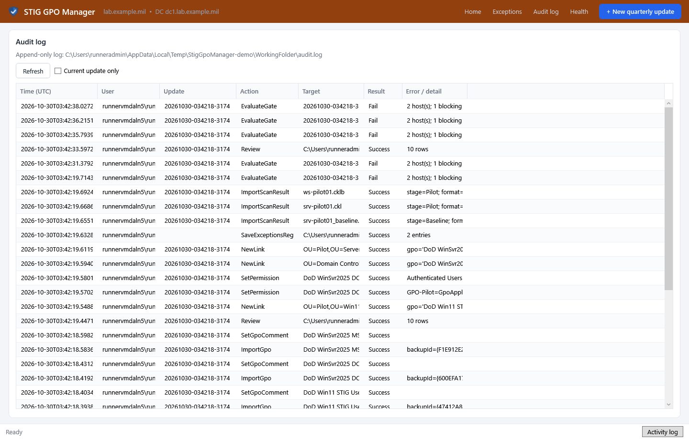 Audit log | 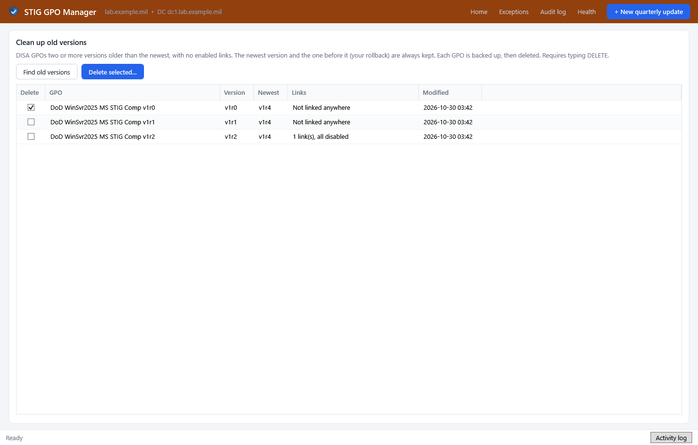 Clean up old versions |

Screenshots are taken automatically on a Windows build machine in demo mode (`/screenshots`).
</details>

## Rolling back

**Roll back this update** (in the update) or **Roll back** (in History) uses what the tool recorded,
not guesswork. Before the update first changed an OU, it saved that OU's link order. Rollback
re-enables the old version's links first, so no OU is left without a STIG GPO, then disables the new
version's links and restores the recorded order. Exception GPOs still stay on top. It works after
Pilot or after Promote, and from the command line:
`StigGpoManager.exe cli rollback --run <id> --whatif`, then `--yes`.

Without the tool, the run report's *Link changes* table lists every OU with its link order before and
after each change, so it can be undone by hand in GPMC.

## Settings reference

The setup wizard writes `%ProgramData%\StigGpoManager\config.json` (Administrators and SYSTEM only).
You rarely need to edit it by hand; if you do, problems are listed under **Health** with their line and column.

| Setting | Meaning |
|---|---|
| `Domain` | DNS name of the domain. Every target OU must be inside it, so a lab config can't run against production. |
| `TargetDC` | `auto-pdc` (default) sends every change to the PDC emulator; or a DC FQDN. |
| `ExceptionPrefix` | Name prefix of your exception GPOs, e.g. `SITE - `. They always stay above DISA GPOs. |
| `DisaGpoPrefix` | Name prefix of DISA GPOs, normally `DoD `. |
| `WorkingFolder` | Run history, backups, reports, exceptions register and audit log. Local path or UNC. |
| `Language` | ADML language copied to the Central Store, e.g. `en-US`. |
| `PilotGroup` | Group for group-based pilot (mappings without pilot OUs). |
| `SoakDays` | Pilot soak length shown on the calendar and tray. Default 14. |
| `RequireScanGate` | Block Promote until pilot scan results pass. Default `true`. |
| `WriteGpoComment` | Write package, version and import date into each new GPO's comment. Default `true`. |
| `MigrationTable` | `auto` (default): when DISA's backups name groups from DISA's own domain (Domain Admins, Enterprise Admins...), the import maps them to this domain's groups with a migration table (shown in the Import confirmation, saved with the run). `none`: import unchanged. Or the path of a `.migtable` made in the GPMC Migration Table Editor. |
| `CentralStorePath` | Only if the Central Store isn't at `\\<domain>\SYSVOL\<domain>\Policies\PolicyDefinitions`. |

Each **mapping** says how a DISA GPO is named and linked: `Match` (regex on the GPO name in DISA's
package), `NameTemplate` (new GPO name containing `{Version}`, e.g. `DoD WinSvr2025 MS STIG Comp {Version}`),
`ProdTargets`, `PilotTargets`, and optionally `PilotMode` (`OU`, `Group` or `None`). See
`config.sample.json` for a complete example. `StigGpoManager.exe cli detect [--save]` prints or saves
a detected configuration.

## Where data lives

```
%ProgramFiles%\StigGpoManager\StigGpoManager.exe
%ProgramData%\StigGpoManager\config.json        Administrators/SYSTEM only
<WorkingFolder>\
  audit.log                 append-only, one JSON object per line (who, what, target, result)
  exceptions.json           exceptions register (previous versions in exceptions-history\)
  runs\<runId>.json         one file per quarterly update: package hash, GPOs created, every link
                            change with before/after order, confirmations, scan results, gate
  runs\<runId>\scans\       imported scan results (evidence)
  packages\  backups\  reports\
```

The run report (**Report** in History) collects it all for the SSP / POA&M: package and hash, GPOs,
every link change, confirmations, backups, scan evidence and gate outcome, and that update's audit entries.

## Command line

Run from an elevated console. Commands that change AD print their plan and act only with `--yes`
(or `--confirm PROMOTE` / `--confirm DELETE`); `--whatif` never acts. The exe is a Windows program, so in
PowerShell pipe its output to make the shell wait and set `$LASTEXITCODE`, e.g.
`& "C:\Program Files\StigGpoManager\StigGpoManager.exe" cli preflight | Out-Host`. That also works over
WinRM (`Invoke-Command`). Exit codes: 0 success, 1 error, 2 blocked or confirmation needed.

```
StigGpoManager.exe cli detect [--save]
StigGpoManager.exe cli preflight [--dcdiag]
StigGpoManager.exe cli load <zip> [--hash <sha256>]
StigGpoManager.exe cli runs
StigGpoManager.exe cli central-store --run <id> --yes
StigGpoManager.exe cli import --run <id> --yes
StigGpoManager.exe cli review --run <id>
StigGpoManager.exe cli pilot --run <id> --yes
StigGpoManager.exe cli import-scan --run <id> --stage Pilot <files>
StigGpoManager.exe cli promote --run <id> --confirm PROMOTE
StigGpoManager.exe cli refresh --run <id> --yes
StigGpoManager.exe cli rollback --run <id> [--gpo "<name>"] --yes
StigGpoManager.exe cli cleanup [--delete "<name>" ... --confirm DELETE]
StigGpoManager.exe cli report --run <id>
StigGpoManager.exe cli version
```

## How link order is decided

On every OU, **every exception GPO is above every DISA GPO**. An exception found below a DISA GPO is
moved up and the move is reported. A new DISA version goes **directly above its previous version**; if
there is none on that OU, directly below the last exception GPO. Other links keep their order. The
order is re-read after every change and verified, and an Enforced DISA link is reported.

## Building from source

On a connected machine with the .NET 8 SDK (NuGet supplies build-time reference assemblies only):

- `.\build.ps1` (Windows) or `./build.sh` (Linux/macOS, Microsoft's SDK build): runs the tests and
  builds `dist\StigGpoManager.exe`.
- The installer is built with [Inno Setup 6](https://jrsoftware.org/isinfo.php):
  `ISCC.exe /DAppVersion=1.0.0 /DAppVersionNum=1.0.0.0 packaging\installer\StigGpoManager.iss`.
- GitHub Actions does all of this on every push: unit tests on Windows, the exe, the installer, a
  silent install / upgrade / uninstall test, a launch check and the screenshots. Running the workflow
  by hand with a `release_tag` creates a draft release.

```
src/Core/   all logic, no UI: package discovery, mapping, Central Store, GPO report diff, exception
            cross-check, link ordering, run state, audit log, scan parsers and gate, setup detection,
            quarterly calendar, and the workflow engine over the IGpoDirectory interface
src/App/    the exe: PowerShell gateway (the only code that calls GroupPolicy/AD cmdlets), WPF UI,
            setup wizard, tray, CLI, demo data
tests/      xUnit tests (78), including whole quarterly cycles against an in-memory AD
packaging/  Inno Setup script
```

## Status and limits

- **Not yet run against a real domain.** The logic and full quarterly cycles are tested against a
  simulated AD, and the exe and installer are built and exercised on Windows. The PowerShell/AD path
  needs a full lab quarter first: prepare, pilot, promote, roll back and clean up, then check the audit log.
- User rights and restricted groups are compared by member SID, so DISA reordering members or printing
  a SID instead of a name is not reported as a change. A replaced right your exception GPO lacks an
  entry for is named with its SID.
- A package that holds the same GPO twice (it happens with Adobe) is resolved the same way every time:
  highest version, then newest backup, then folder path; the other copy is skipped and labelled.
- The review understands security settings (account policy, user rights, security options, restricted
  groups, services, audit), Administrative Templates, advanced audit and registry settings; other
  extensions (firewall, preferences) are compared item by item.
- DISA GPOs are never edited, and exception GPOs are never created or changed. The tool creates new
  GPOs from DISA's backups, links, orders, enables and disables them, sets security filtering for group
  pilots, and deletes old versions only when you ask.
